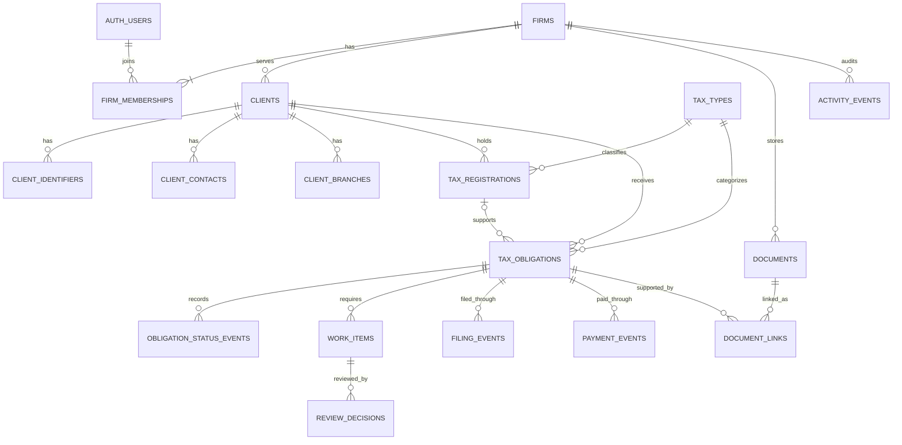

# TaxOS — Logical ERD and Legacy Table Disposition

**Document ID:** DOC-17  
**Version:** 0.1  
**Status:** Proposed logical schema for review; not executable SQL  
**Date:** 24 November 2026  
**Depends on:** DOC-13, DOC-14, DOC-15, DOC-16

## 1. Purpose

Translate the approved product direction and proposed tax domain into a reviewable logical data model. This document identifies entities, ownership, cardinality, tenant keys, relationship constraints, and the disposition of the legacy schema.

It is not a physical PostgreSQL schema, migration script, or authorization approval. Column types, indexes, policies, triggers, and migration sequencing must be designed and tested separately.

## 2. Logical architecture

The database is divided into six logical areas:

1. **Identity and tenancy:** users, professional profiles, firms, memberships, invitations, firm settings.
2. **Client registry:** clients, identifiers, contacts, branches, assignments, tax registrations, tax profile facts.
3. **Tax reference and rules:** tax types, legal sources, rule versions, obligation templates, checklist templates.
4. **Tax operations:** obligations, status events, work items, checklist instances, review decisions, filing events, payment events.
5. **Evidence and audit:** documents, document links, activity events.
6. **Office operations:** notifications, calendar entries, firm subscriptions.

Every firm-owned entity must have a firm tenant key. Shared reference catalogues may be global only if they contain no tenant-specific confidential content. Office-specific templates, notes, research, and cases must be tenant-owned or explicitly shared under a separate reviewed sharing model.

## 3. Entity inventory

### 3.1 Identity and tenancy

| Entity | Tenant-owned? | Primary relationships | Notes |
|---|---|---|---|
| `user_profiles` | No (identity-level) | auth user | Individual profile, language and contact preferences; no firm authority stored here |
| `professional_profiles` | User-owned | auth user | Optional credentials and professional details; not a tenant |
| `firms` | Root tenant | memberships, clients, settings, subscription | One accounting office |
| `firm_memberships` | Yes | firm, auth user | Role and membership status; unique firm/user relationship |
| `firm_invitations` | Yes | firm, inviter, accepted user | Email-bound, expiring, single-use invitation |
| `firm_settings` | Yes | firm | Office preferences, locale, timezone, workflow defaults |
| `firm_subscriptions` | Yes | firm | Office-owned commercial subscription |

Membership authorization must use the authenticated subject plus an active membership. A selected firm in the Flutter UI is only context, never proof of access.

### 3.2 Client registry

| Entity | Tenant key | Relationships | Notes |
|---|---|---|---|
| `clients` | `firm_id` | contacts, identifiers, branches, registrations, obligations | Office's taxpayer/client master record |
| `client_identifiers` | `firm_id` | client | Typed and protected official identifiers |
| `client_contacts` | `firm_id` | client | Multiple contacts with explicit contact permissions |
| `client_branches` | `firm_id` | client | Main and branch locations |
| `client_assignments` | `firm_id` | client, membership | Optional workload ownership; not MVP authorization boundary |
| `tax_registrations` | `firm_id` | client, tax type | One client may have multiple registrations |
| `client_tax_facts` | `firm_id` | client, optional registration | Effective-dated facts with source and verification metadata |

### 3.3 Tax catalogue and rules

| Entity | Tenant key | Relationships | Notes |
|---|---|---|---|
| `tax_types` | Global reference | obligation templates, registrations | Stable keys, localized labels, active/retired state |
| `legal_sources` | Global or firm-owned depending on source class | rule versions, obligations | Law, regulation, decree, circular, ETA instruction, official notice |
| `tax_rule_versions` | Global or firm-owned | legal source, tax type | Effective-dated, reviewed, versioned rules; no unverified hard-coded deadlines |
| `obligation_templates` | Global or firm-owned | tax type, rule version, checklist template | Optional reusable definitions for recurring/event-driven work |
| `checklist_templates` | Global or firm-owned | obligation template | Versioned checklist definitions |

The global-vs-firm-owned policy for research content must be decided separately. An office's annotations and legal interpretations are private by default.

### 3.4 Tax operations

| Entity | Tenant key | Relationships | Notes |
|---|---|---|---|
| `tax_obligations` | `firm_id` | client, registration, tax type, rule/template, work items | One actual compliance responsibility for one client and period/event |
| `obligation_status_events` | `firm_id` | obligation, actor membership | Append-only lifecycle history |
| `work_items` | `firm_id` | obligation, assignee membership | Office task; separate from obligation state |
| `work_item_dependencies` | `firm_id` | predecessor and successor work items | Optional dependency graph; no cross-firm edges |
| `checklist_instances` | `firm_id` | obligation/work item, source template version | Snapshot created from template |
| `checklist_item_instances` | `firm_id` | checklist instance | Completion, evidence, actor, timestamp |
| `review_decisions` | `firm_id` | obligation/work item, reviewer membership | Approved, changes requested, rejected |
| `filing_events` | `firm_id` | obligation, evidence links | Original/amended/corrected submission record |
| `payment_events` | `firm_id` | obligation, evidence links | Payment, installment, refund, reversal, offset, adjustment |

### 3.5 Evidence, audit, and office operations

| Entity | Tenant key | Relationships | Notes |
|---|---|---|---|
| `documents` | `firm_id` | uploader membership, document links | Metadata and private storage object key |
| `document_links` | `firm_id` | document and one supported target entity | Explicit typed links; validate firm and client consistency |
| `activity_events` | `firm_id` | actor membership, target entity | Append-only audit/activity timeline |
| `notifications` | `firm_id` | recipient user/membership, target entity | User-specific delivery state |
| `calendar_entries` | `firm_id` | obligation, work item, owner | Derived or materialized office calendar item |
| `firm_subscriptions` | `firm_id` | firm | Plan and billing provider metadata |

## 4. Relationship cardinalities

The following cardinalities are the target logical model:

- One auth user may have zero or many firm memberships.
- One firm has one or many memberships and may have many clients.
- One client has zero or many contacts, identifiers, branches, tax registrations, and obligations.
- One tax registration belongs to exactly one client and one firm.
- One tax type may be referenced by many registrations, templates, and obligations.
- One obligation belongs to exactly one client and one firm; it may reference one relevant registration.
- One obligation has zero or many work items, status events, review decisions, filing events, payment events, and document links.
- One work item belongs to one firm and one obligation; dependencies are between work items in the same firm.
- One document belongs to one firm and may be linked to multiple supported records in that firm.
- One firm has one current subscription record at a time, while subscription history may be retained as separate periods/events.
- One user may receive notifications from multiple firms; each notification has exactly one firm context and one recipient.

## 5. Tenant integrity rules

### 5.1 Composite ownership keys

For every firm-owned parent, provide a unique key on `(firm_id, id)`. Child relationships should carry `firm_id` and reference the parent's composite key.

Illustrative relationship patterns (not SQL):

- `tax_obligations(firm_id, client_id)` → `clients(firm_id, id)`
- `tax_obligations(firm_id, tax_registration_id)` → `tax_registrations(firm_id, id)`
- `tax_registrations(firm_id, client_id)` → `clients(firm_id, id)`
- `work_items(firm_id, obligation_id)` → `tax_obligations(firm_id, id)`
- `filing_events(firm_id, obligation_id)` → `tax_obligations(firm_id, id)`
- `payment_events(firm_id, obligation_id)` → `tax_obligations(firm_id, id)`
- `documents(firm_id, uploaded_by_membership_id)` → `firm_memberships(firm_id, id)`

Where a child references multiple parents (e.g. a document link to both a document and an obligation), all references must be validated against the same firm. If the relationship also requires same-client consistency, enforce that too.

### 5.2 Membership references

Where a record refers to an employee, prefer the membership identifier rather than a bare user ID when the action is performed in a specific firm context. A user may have multiple memberships, so a bare user ID does not identify which firm's role authorized the action.

The database must also ensure that the referenced membership is active and has the required permission at the time of the operation. A foreign key alone does not enforce active status or permission.

### 5.3 Document link integrity

Avoid a generic `entity_type + entity_id` polymorphic link if it cannot be protected by real foreign keys. Prefer typed link tables or a constrained parent/link structure for supported entity types.

For MVP, typed link tables may be clearer:
- `client_documents`
- `obligation_documents`
- `work_item_documents`
- `filing_event_documents`
- `payment_event_documents`

Choose the smallest maintainable approach that preserves actual FK enforcement and same-firm/same-client guarantees.

### 5.4 Audit integrity

Audit events should not cascade-delete with business records. Use stable entity identifiers and safe snapshots/metadata that survive archival, with retention and legal-hold rules reviewed separately.

## 6. Conceptual ERD (simplified)

This diagram is conceptual. It intentionally omits several FK details and does not replace the tenant-aware relationship rules above.

## 7. Legacy schema disposition

| Legacy table/object | Proposed disposition | Reason / action |
|---|---|---|
| `accountants` | Split / migrate selectively | Preserve individual professional profile fields where useful; move office identity/settings into `firms`; do not treat accountant row as tenant |
| `clients` | Redesign and migrate selectively | Preserve usable contact/business data; add firm scope, client types, typed identifiers, contacts, branches, and Egyptian fields |
| `tax_profiles` | Replace with effective-dated client tax facts/registrations | Existing filing status/dependents/state concepts are US-person oriented |
| `tax_returns` | Legacy/archive; replace as Egyptian obligations are introduced | Existing table is a US 1040 return header, not a generic tax obligation |
| `income_entries` | Retire from Egyptian v1; archive if data retention requires | Federal/state withholding and US income categories |
| `deduction_entries` | Retire from Egyptian v1; archive if data retention requires | US individual-return deduction categories |
| `credit_entries` | Retire from Egyptian v1; archive if data retention requires | US individual-return tax credits |
| `return_documents` | Replace with typed document links | Tied to legacy return model; parent integrity requires redesign |
| `expenses` | Defer / optional module | Consumer expense tracking is not the Egyptian office operating core; decide whether firm bookkeeping needs justify retention |
| `documents` | Retain concept; redesign tenancy and links | Document vault is reusable, but firm ownership, storage paths, versions, and typed links must be corrected |
| `billing_contacts` | Reassess / adapt | Could support office service billing; not automatically a taxpayer contact model |
| `invoices`, `invoice_line_items` | Defer and separate from tax obligations | Office fee invoices are not ETA e-invoices and are not tax filings |
| `subscriptions` | Replace ownership model | Subscription belongs to the firm, not individual accountant |
| `notifications` | Redesign | Must support firm context, user recipient, event source, delivery state, and deduplication |
| `expense_categories`, `document_categories` | Replace/seed as reviewed references | Existing expense taxonomy contains US/IRS assumptions; document categories need Egyptian office workflow coverage |
| `current_accountant_id()` and related helpers | Retire after controlled cutover | Cannot represent multi-firm membership |
| Existing accountant-scoped RLS policies | Replace in coordinated cutover | Must not coexist permissively with firm policies |
| Existing storage path/policies | Dual-support then retire | Legacy accountant prefix must remain readable during tested transition |

No legacy table should be dropped merely because this table says "retire" or "replace". Data retention, export, legal requirements, customer migration, and explicit approval govern final removal.

## 8. MVP physical schema boundary

The first implementation slice should be limited to:

1. Firms and memberships (after DOC-14 approval).
2. Clients, contacts, identifiers, and branches.
3. Tax registrations and client tax facts.
4. Tax type reference catalogue.
5. Manually created tax obligations and status events.
6. Work items, checklist instances, and review decisions.
7. Documents and typed document links.
8. Filing events and payment events.
9. Append-only activity events and user notifications.

Defer rule-engine tables, automated obligation generation, custom workflow builder, billing, case library, and advanced analytics until the core tenancy and obligation model has passed integration tests.

## 9. Open technical decisions

| Decision | Recommendation | Why |
|---|---|---|
| UUID strategy | Use current repository UUID convention for initial prototype; evaluate UUIDv7 separately under existing ADR gate | Avoid mixing identifier strategy change with domain migration |
| Client identifier storage | Separate typed records with encrypted sensitive values and masked search fields | Avoid generic plaintext tax ID |
| Document links | Typed link tables for MVP | Strong FKs and tenant consistency |
| Audit implementation | Append-only table with database-controlled writes | Preserve trustworthy history |
| Calendar | Derive from obligations/tasks first; materialize only if measured performance requires it | Avoid duplicate state |
| Rule catalogue ownership | Shared official source metadata plus firm-private annotations | Separate law source from office interpretation |
| Tax rule effective dates | Explicit valid_from/valid_to and version state | Historical reproducibility |
| Archive strategy | Soft archive for client/business records; separate retention/purge policy | Avoid destructive cascades |
| Subscription history | Firm-owned subscription periods/events | Support plan changes and billing reconciliation |

## 10. Review checklist before physical SQL design

- [ ] Product approves the MVP entity inventory and legacy disposition.
- [ ] Egyptian tax reviewer validates initial tax type catalogue and terminology.
- [ ] Security approves identifier protection and membership reference model.
- [ ] DOC-14 role/permission matrix is finalized.
- [ ] Every tenant-owned FK relationship is enumerated.
- [ ] Document link strategy is selected and same-firm/same-client invariants are defined.
- [ ] Audit event immutability and retention requirements are approved.
- [ ] Existing data migration/retention decision is documented.
- [ ] Physical schema prototype is tested in a disposable local database with two or more firms.
- [ ] No hosted migration is attempted before explicit approval.

## 11. Next engineering step

After product review of DOC-17, create a disposable local PostgreSQL/Supabase schema prototype for the smallest vertical slice: firms/memberships, clients, registrations, obligations, work items, review decisions, filing/payment events, and document links.

The prototype must include seed data for at least two firms, multiple members in one firm, and one user in two firms. Test both valid access and cross-firm/cross-client negative cases before any application feature is built on top of it.

No SQL migration, deployment, hosted database operation, or destructive data change is authorized by DOC-17.
